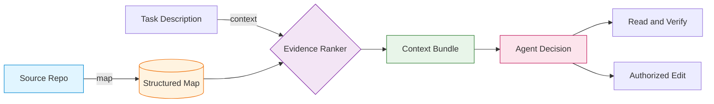
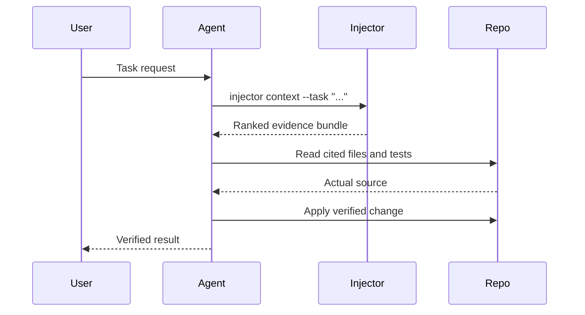

<div align="center">

# ⚡ Injector Engineering

### *Evidence before decisions.*

**A local-first CLI that connects code evidence before your agent decides.**

Caveman saves tokens in what an agent says.<br/>
**Injector connects code evidence before an agent decides.**

<br/>

[](LICENSE)
[](https://nodejs.org)
[](package.json)
[](https://github.com/shaonkabir8/injector-engineering)
[](https://github.com/shaonkabir8/injector-engineering)

</div>

---

<details>
<summary><strong>🇧🇩 বাংলা সংস্করণ — দেখতে ক্লিক করুন</strong></summary>

<br/>

<div align="center">

# ⚡ ইনজেক্টর ইঞ্জিনিয়ারিং

### *সিদ্ধান্তের আগে প্রমাণ।*

**একটি লোকাল-ফার্স্ট CLI, যা আপনার এজেন্ট সিদ্ধান্ত নেওয়ার আগেই কোড-প্রমাণ সংযুক্ত করে।**

Caveman এজেন্ট যা *বলে* তা থেকে টোকেন বাঁচায়।<br/>
**Injector এজেন্ট সিদ্ধান্ত নেওয়ার *আগে* কোড-প্রমাণ সংযুক্ত করে।**

<br/>

**🔒 কোনো মডেল API নেই · 🌐 কোনো নেটওয়ার্ক কল নেই · ✏️ সোর্স এডিট নেই · 📦 কোনো রানটাইম ডিপেন্ডেন্সি নেই**

</div>

***

## সূচিপত্র 📖

- [কেন Injector](#কেন-injector-)
- [কীভাবে কাজ করে](#কীভাবে-কাজ-করে-)
- [দ্রুত শুরু](#দ্রুত-শুরু-)
- [কমান্ড](#কমান্ড-)
- [কী ইনডেক্স করে](#কী-ইনডেক্স-করে-)
- [এজেন্ট ওয়ার্কফ্লো](#এজেন্ট-ওয়ার্কফ্লো-)
- [আর্কিটেকচার](#আর্কিটেকচার-)
- [নিরাপত্তা ও গোপনীয়তা](#নিরাপত্তা-ও-গোপনীয়তা-)
- [সাধারণ প্রশ্ন](#সাধারণ-প্রশ্ন-)
- [ডেভেলপমেন্ট](#ডেভেলপমেন্ট-)
- [লাইসেন্স](#লাইসেন্স-)

***

## কেন Injector 🎯

কোডিং এজেন্ট প্রমাণ ছাড়া অনুমান করে। তারা ফাইল লেআউট আন্দাজ করে, সিম্বল নাম বানায়, এবং ভুল মডিউল এডিট করে। Injector এজেন্ট সিদ্ধান্ত নেওয়ার **আগে** ডিটারমিনিস্টিক, সাইটেড, টাস্ক-ফোকাসড প্রমাণ পৌঁছে দিয়ে এই সমস্যাটি ঠিক করে।

| সমস্যা | Injector-এর উত্তর |
|---|---|
| এজেন্ট কোড স্ট্রাকচার অনুমান করে | ফাইল, সিম্বল, ইমপোর্ট, টেস্টের স্ট্রাকচার্ড ম্যাপ |
| গভীর পাথে লুকানো কনটেক্সট | প্রতি টাস্কে র‍্যাঙ্কড ক্যান্ডিডেট ফাইল |
| ট্রি বারবার পড়ে টোকেনের অপচয় | রেপোর বাইরে ক্যাশ, রান জুড়ে পুনঃব্যবহৃত |
| ক্লাউড কনটেক্সট API-তে প্রাইভেসি ঝুঁকি | ১০০% লোকাল, শূন্য নেটওয়ার্ক, কোনো মডেল কল নেই |
| ভুল মডিউল এডিট | সোর্সের সাথে সংশ্লিষ্ট টেস্ট দেখানো হয় |

***

## কীভাবে কাজ করে 🔍

```text
┌────────────────┐     ┌───────────────────┐     ┌──────────────────┐
│  Source Repo   │ ──► │  injector map .   │ ──► │  Structured Map  │
│  (local files) │     │  (lexical scan)   │     │  (cache/JSON)    │
└────────────────┘     └───────────────────┘     └────────┬─────────┘
                                                          │
                                                          ▼
┌────────────────┐     ┌───────────────────┐     ┌──────────────────┐
│  Agent Decides │ ◄── │ injector context  │ ◄── │  Task Description│
│  and Verifies  │     │  --task "..."     │     │  + Ranked Bundle │
└────────────────┘     └───────────────────┘     └──────────────────┘
```



র‍্যাঙ্কিং হলো ডিটারমিনিস্টিক ওয়ার্ড ওভারল্যাপ — সেমান্টিক সার্চ নয়, আর ডায়াগনসিসও নয়। ইমপ্লিমেন্টেশন বেছে নেওয়ার আগে সবসময় সাইটেড ফাইল ও টেস্ট পড়ুন।

***

## দ্রুত শুরু 🚀

Node.js 18 বা তার পরের ভার্সন প্রয়োজন।

### গ্লোবালি ইনস্টল করুন

```bash
git clone https://github.com/shaonkabir8/injector-engineering.git
cd injector-engineering
npm install -g .
```

### অথবা সরাসরি চালান — ইনস্টল ছাড়াই

```bash
node /path/to/injector-engineering/bin/injector.js <command>
```

### আপনার রেপোতে ব্যবহার করুন

```bash
cd /path/to/your/repository

# ১. ম্যাপ তৈরি করুন
injector map .

# ২. টাস্ক-ফোকাসড কনটেক্সট চান
injector context . --task "session expiry validation"
```

`injector map` তার ক্যাশ রেপোর বাইরে, আপনার ইউজার ক্যাশ ডিরেক্টরিতে লেখে। `INJECTOR_CACHE_HOME` দিয়ে ওভাররাইড করা যায়। পোর্টেবল ম্যাপ এক্সপোর্ট করতে `--out <file>` ব্যবহার করুন। সেই ফাইলে রেপো পাথ ও সিম্বল মেটাডেটা থাকে — সোর্স টেক্সট নয়।

***

## কমান্ড 🛠

```text
injector map     [directory] [--out <file>] [--json]
injector context [directory] --task <description> [--map <file>] [--limit <count>]
injector --help
```

`map` এবং `context` — উভয়ই JSON প্রিন্ট করে। কনটেক্সট বান্ডলে থাকে:

- র‍্যাঙ্কড ক্যান্ডিডেট ফাইল
- ম্যাচিং সিম্বল
- ইমপোর্ট স্টেটমেন্ট
- সংশ্লিষ্ট টেস্ট
- ডিপেন্ডেন্সি এজ

***

## কী ইনডেক্স করে 📦

| ভাষা | এক্সটেনশন |
|---|---|
| JavaScript | `.js` `.cjs` `.mjs` `.jsx` |
| TypeScript | `.ts` `.cts` `.mts` `.tsx` |
| Python | `.py` |

স্বয়ংক্রিয়ভাবে বাদ পড়ে:

- জেনারেটেড ডিরেক্টরি
- `node_modules` ও `vendor`-এর মতো ডিপেন্ডেন্সি ডিরেক্টরি
- `.git` ও `.hg`-এর মতো VCS মেটাডেটা
- ১ MiB-এর চেয়ে বড় ফাইল — ম্যাপ সামারিতে গণনা করা হয়

সিম্বল ও টেস্ট সম্পর্ক হালকা লেক্সিকাল ইঙ্গিত — পূর্ণ ভাষা পার্সার নয়।

***

## এজেন্ট ওয়ার্কফ্লো 🤖

[`skills/injector/SKILL.md`](skills/injector/SKILL.md) আপনার কোডিং এজেন্টের স্কিল ডিরেক্টরিতে ইনস্টল বা কপি করুন।

অ্যাক্টিভেশন ট্রিগার: `Injector Required` এবং `Injection Required`।

চুক্তিটি হলো:

1. রেপো ইঞ্জিনিয়ারিং সিদ্ধান্তের **আগে** টাস্ক-ফোকাসড প্রমাণ সংগ্রহ করুন
2. প্রকৃত সোর্স ও টেস্ট পরিদর্শন করুন
3. তারপরই অনুমোদিত পরিবর্তন প্রয়োগ করুন



***

## আর্কিটেকচার 🏗

```text
injector-engineering/
├── bin/
│   └── injector.js          # CLI এন্ট্রিপয়েন্ট
├── skills/
│   └── injector/
│       └── SKILL.md         # এজেন্ট স্কিল চুক্তি
├── src/                     # কোর স্ক্যানার, র‍্যাঙ্কার, ক্যাশ
├── test/                    # টেস্ট স্যুট
├── package.json
└── LICENSE
```

ডিজাইন নীতিমালা:

- শূন্য রানটাইম ডিপেন্ডেন্সি: খাঁটি Node.js স্ট্যান্ডার্ড লাইব্রেরি
- শূন্য নেটওয়ার্ক কোড: কখনো মডেল প্রোভাইডার আহ্বান করে না
- রেপোর বাইরে ক্যাশ: আপনার ওয়ার্কিং ট্রি পরিষ্কার রাখে
- ডিটারমিনিস্টিক র‍্যাঙ্কিং: পুনরুৎপাদনযোগ্য প্রমাণ, কোনো লুকানো স্টেট নেই

***

## নিরাপত্তা ও গোপনীয়তা 🔐

| নিশ্চয়তা | বিস্তারিত |
|---|---|
| কোনো নেটওয়ার্ক নেই | CLI-তে কোনো নেটওয়ার্ক কোড নেই এবং এটি মডেল প্রোভাইডার আহ্বান করে না। |
| শুধু লোকাল রিড | লোকালি সাপোর্টেড সোর্স ফাইল পড়ে এবং শুধু রিলেটিভ পাথ, সিম্বল নাম, ইমপোর্ট স্ট্রিং, হ্যাশ, সাইজ ও সম্পর্ক সংরক্ষণ করে। |
| রেপোর বাইরে ক্যাশ | ডিফল্ট ক্যাশ রেপোর বাইরে থাকে। ম্যানুয়ালি এক্সপোর্ট করা ম্যাপ অভ্যন্তরীণ পাথ ও সিম্বল নাম প্রকাশ করতে পারে — তাই শেয়ার করার আগে পর্যালোচনা করুন। |
| কোনো সোর্স এডিট নেই | কখনো অ্যাপ্লিকেশন সোর্স পরিবর্তন করে না। `--out` শুধু আপনার নির্দিষ্ট করা ম্যাপ ফাইল লেখে। |

***

## সাধারণ প্রশ্ন ❓

<details>
<summary><strong>এটি কি সেমান্টিক সার্চ?</strong></summary>

না। র‍্যাঙ্কিং ডিটারমিনিস্টিক ওয়ার্ড ওভারল্যাপ ব্যবহার করে। এটি একটি দ্রুত, পুনরুৎপাদনযোগ্য ফিল্টার — এবং সাইটেড কোড আপনাকে এখনও পড়তে হবে।

</details>

<details>
<summary><strong>এটি কি LLM কল করে?</strong></summary>

কখনো না। Injector-এ কোনো নেটওয়ার্ক কোড নেই এবং কোনো মডেল ইন্টিগ্রেশন নেই।

</details>

<details>
<summary><strong>ক্যাশ কোথায় থাকে?</strong></summary>

আপনার OS-এর ইউজার ক্যাশ ডিরেক্টরিতে। `INJECTOR_CACHE_HOME` দিয়ে ওভাররাইড করুন, অথবা `--out <file>` দিয়ে পোর্টেবল ম্যাপ এক্সপোর্ট করুন।

</details>

<details>
<summary><strong>এটি কি আমার সোর্স পরিবর্তন করে?</strong></summary>

না। `map` ও `context` শুধু পড়ে। `--out` শুধু আপনার নির্দিষ্ট করা ম্যাপ ফাইল লেখে।

</details>

<details>
<summary><strong>কোন ভাষাগুলো সাপোর্টেড?</strong></summary>

JavaScript (`.js`, `.cjs`, `.mjs`, `.jsx`), TypeScript (`.ts`, `.cts`, `.mts`, `.tsx`), এবং Python (`.py`)।

</details>

***

## ডেভেলপমেন্ট 💻

```bash
npm test
```

- কোনো থার্ড-পার্টি রানটাইম ডিপেন্ডেন্সি নেই
- MIT লাইসেন্সড
- Node.js 18 ও তার পরের ভার্সন

অবদান স্বাগতম। বড় PR করার আগে অনুগ্রহ করে একটি ইস্যু খুলুন।

***

## লাইসেন্স 📄

[MIT License](LICENSE)-এর অধীনে প্রকাশিত।

***

<div align="center">

**⚡ Injector Engineering** — *সিদ্ধান্তের আগে প্রমাণ।*

`#coding-agents` `#local-first` `#cli` `#code-context` `#ai-tools` `#developer-tools` `#static-analysis` `#zero-dependencies` `#privacy-first` `#typescript` `#python` `#nodejs`

<br/>

**তাদের জন্য তৈরি, যারা লেখার আগে পড়ে।**

</div>

</details>

<details open>
<summary><strong>🇬🇧 English Version — click to collapse</strong></summary>

<br/>

<div align="center">

# ⚡ Injector Engineering

### *Evidence before decisions.*

**A local-first CLI that connects code evidence before your agent decides.**

Caveman saves tokens in what an agent says.<br/>
**Injector connects code evidence before an agent decides.**

<br/>

[**🚀 Quick Start**](#quick-start-) · [**📖 Commands**](#commands-) · [**🤖 Agent Skill**](#agent-workflow-) · [**🔐 Security**](#security-and-privacy-) · [**❓ FAQ**](#faq-)

<br/>

**🔒 No model API · 🌐 No network calls · ✏️ No source edits · 📦 No runtime dependencies**

</div>

***

## Table of Contents 📖

- [Why Injector](#why-injector-)
- [How It Works](#how-it-works-)
- [Quick Start](#quick-start-)
- [Commands](#commands-)
- [What It Indexes](#what-it-indexes-)
- [Agent Workflow](#agent-workflow-)
- [Architecture](#architecture-)
- [Security and Privacy](#security-and-privacy-)
- [FAQ](#faq-)
- [Development](#development-)
- [License](#license-)

***

## Why Injector 🎯

Coding agents hallucinate when they lack evidence. They guess at file layouts, invent symbol names, and edit the wrong module. Injector fixes this by delivering deterministic, cited, task-focused evidence before the agent decides.

| Problem | Injector's Answer |
|---|---|
| Agent guesses at code structure | Structured map of files, symbols, imports, tests |
| Hidden context buried in deep paths | Ranked candidate files per task |
| Repeated token waste re-reading trees | Cache outside the repo, reused across runs |
| Privacy risk with cloud context APIs | 100% local, zero network, no model calls |
| Wrong module edited | Related tests surfaced with the source |

***

## How It Works 🔍

```text
┌────────────────┐     ┌───────────────────┐     ┌──────────────────┐
│  Source Repo   │ ──► │  injector map .   │ ──► │  Structured Map  │
│  (local files) │     │  (lexical scan)   │     │  (cache/JSON)    │
└────────────────┘     └───────────────────┘     └────────┬─────────┘
                                                          │
                                                          ▼
┌────────────────┐     ┌───────────────────┐     ┌──────────────────┐
│  Agent Decides │ ◄── │ injector context  │ ◄── │  Task Description│
│  and Verifies  │     │  --task "..."     │     │  + Ranked Bundle │
└────────────────┘     └───────────────────┘     └──────────────────┘
```


Ranking is deterministic word overlap, not semantic search, and not a diagnosis. Always read the cited files and tests before choosing an implementation.

***

## Quick Start 🚀

Requires Node.js 18 or later.

### Install globally

```bash
git clone https://github.com/shaonkabir8/injector-engineering.git
cd injector-engineering
npm install -g .
```

### Or run directly, no install

```bash
node /path/to/injector-engineering/bin/injector.js <command>
```

### Use it in your repo

```bash
cd /path/to/your/repository

# 1. Build the map
injector map .

# 2. Ask for task-focused context
injector context . --task "session expiry validation"
```

`injector map` writes its cache outside the repository, under your user cache directory. Override with `INJECTOR_CACHE_HOME`. Use `--out <file>` to export a portable map. That file contains repository paths and symbol metadata, not source text.

***

## Commands 🛠

```text
injector map     [directory] [--out <file>] [--json]
injector context [directory] --task <description> [--map <file>] [--limit <count>]
injector --help
```

Both `map` and `context` print JSON. The context bundle contains:

- Ranked candidate files
- Matching symbols
- Import statements
- Related tests
- Dependency edges

***

## What It Indexes 📦

| Language | Extensions |
|---|---|
| JavaScript | `.js` `.cjs` `.mjs` `.jsx` |
| TypeScript | `.ts` `.cts` `.mts` `.tsx` |
| Python | `.py` |

Skipped automatically:

- Generated directories
- Dependency directories such as `node_modules` and `vendor`
- VCS metadata such as `.git` and `.hg`
- Files larger than 1 MiB, counted in the map summary

Symbol and test relationships are lightweight lexical hints, not a full language parser.

***

## Agent Workflow 🤖

Install or copy [`skills/injector/SKILL.md`](skills/injector/SKILL.md) into your coding agent's skill directory.

Activation triggers: `Injector Required` and `Injection Required`.

The contract:

1. Retrieve task-focused evidence before repository engineering decisions
2. Inspect the actual source and tests
3. Only then apply authorized changes


***

## Architecture 🏗

```text
injector-engineering/
├── bin/
│   └── injector.js          # CLI entrypoint
├── skills/
│   └── injector/
│       └── SKILL.md         # Agent skill contract
├── src/                     # Core scanner, ranker, cache
├── test/                    # Test suite
├── package.json
└── LICENSE
```

Design principles:

- Zero runtime dependencies: pure Node.js standard library
- Zero network code: never invokes model providers
- Cache outside the repo: keeps your working tree clean
- Deterministic ranking: reproducible evidence, no hidden state

***

## Security and Privacy 🔐

| Guarantee | Detail |
|---|---|
| No network | The CLI contains no network code and does not invoke model providers. |
| Local-only reads | Reads supported source files locally and stores only relative paths, symbol names, import strings, hashes, sizes, and relationships. |
| Out-of-repo cache | Default cache lives outside the repository. A manually exported map can reveal internal path and symbol names, so review before sharing. |
| No source edits | Never modifies application source. `--out` writes only the map file you specify. |

***

## FAQ ❓

<details>
<summary><strong>Is this semantic search?</strong></summary>

No. Ranking uses deterministic word overlap. It is a fast, reproducible filter, and you still read the cited code.

</details>

<details>
<summary><strong>Does it call an LLM?</strong></summary>

Never. Injector has no network code and no model integration.

</details>

<details>
<summary><strong>Where does the cache live?</strong></summary>

Under your OS user cache directory. Override with `INJECTOR_CACHE_HOME`, or export a portable map with `--out <file>`.

</details>

<details>
<summary><strong>Does it modify my source?</strong></summary>

No. `map` and `context` only read. `--out` writes only the map file you specify.

</details>

<details>
<summary><strong>Which languages are supported?</strong></summary>

JavaScript (`.js`, `.cjs`, `.mjs`, `.jsx`), TypeScript (`.ts`, `.cts`, `.mts`, `.tsx`), and Python (`.py`).

</details>

***

## Development 🧑💻

```bash
npm test
```

- No third-party runtime dependencies
- MIT licensed
- Node.js 18 and later

Contributions welcome. Please open an issue before large PRs.

***

## License 📄

Released under the [MIT License](LICENSE).

***

<div align="center">

**⚡ Injector Engineering** — *evidence before decisions.*

`#coding-agents` `#local-first` `#cli` `#code-context` `#ai-tools` `#developer-tools` `#static-analysis` `#zero-dependencies` `#privacy-first` `#typescript` `#python` `#nodejs`

<br/>

**Built for agents that read before they write.**

</div>

</details>
